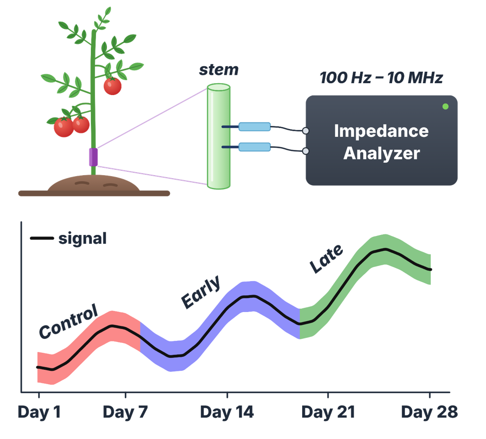
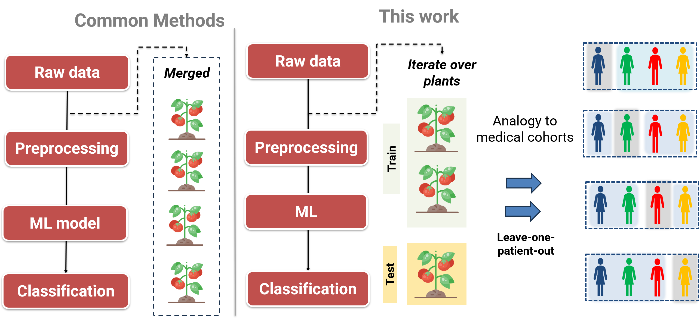
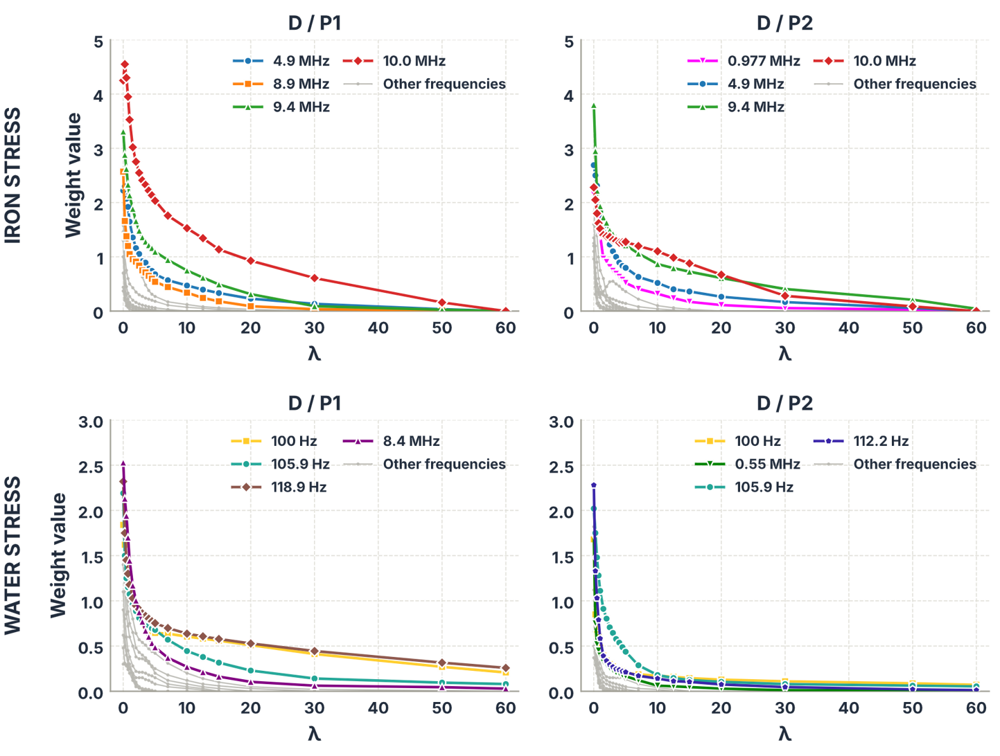
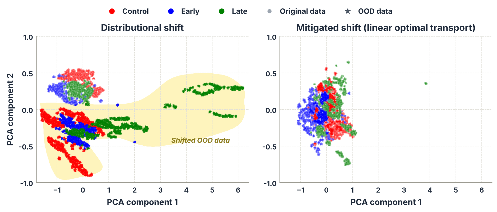
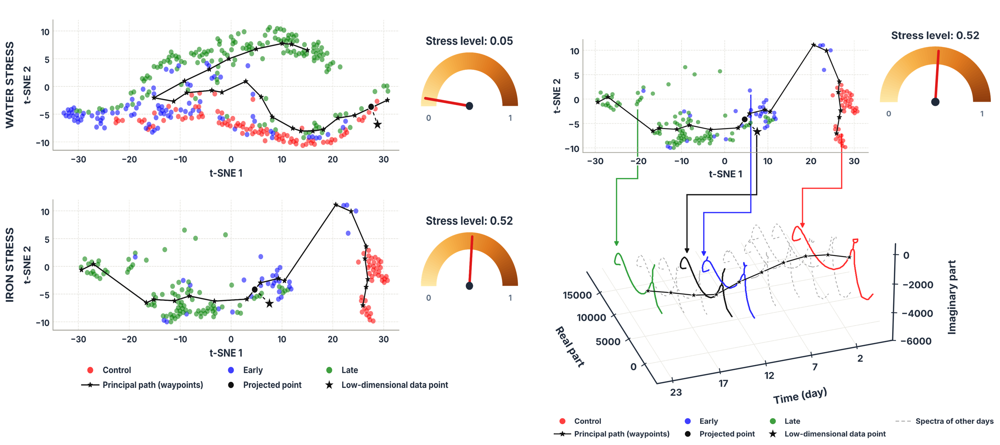

# Generalization and Distributional Shift in Plant Stress Classification with Bioimpedance Spectroscopy

[](https://doi.org/10.1016/j.atech.2026.102510)
[](https://bioimpedance-plant-stress-dashboard-9kwcagywp7zqoeya3xnjqm.streamlit.app)


Code for the paper **"On generalization and distributional shift in water and iron plant stress classification using bioimpedance spectroscopy"**, Smart Agricultural Technology, vol. 15, 102510 (2026).

H. Al Haj Ali, P. Ibba, L. Petti, D. Fragouli, C. Bartolozzi, S. Decherchi, A. Athanassiou

<p align="center">
  
</p>

Stem bioimpedance spectra (100 Hz to 10 MHz, 200 frequency points) of tomato plants are classified into **control**, **early stress** and **late stress**, for both water stress and iron stress. The repository covers the three parts of the paper:

1. **Plant-wise generalization.** An ElasticNet classifier on raw spectra, evaluated with leave-one-plant-out cross-validation.
2. **Distributional shift.** Linear optimal transport to adapt the model to a new, out-of-distribution (OOD) water-stress experiment.
3. **Stress progression.** A principal path in t-SNE space that turns a spectrum into a continuous stress level.

## Main results

| Setting | Iron stress | Water stress |
|---|---|---|
| Mixed-sample split (common practice) | 0.92 | 0.93 |
| Leave-one-plant-out, full spectrum | 0.54 | 0.57 |
| Leave-one-plant-out, selected frequencies | **0.84 ± 0.01** | **0.80 ± 0.04** |

Selected bands: 4.9 to 10 MHz for iron stress, 100 to 120 Hz for water stress.

| OOD water-stress data | Accuracy |
|---|---|
| No adaptation | 0.38 ± 0.00 |
| CORAL | 0.43 ± 0.12 |
| Subspace alignment | 0.39 ± 0.15 |
| Linear optimal transport, control-only calibration | 0.53 ± 0.04 |
| Linear optimal transport, three-class calibration | **0.71 ± 0.04** |

Accuracy is over three classes, so chance level is 0.33.

## Method

### 1. Leave-one-plant-out validation

Mixing samples from all plants before splitting lets the model see the test plant during training and inflates accuracy. Here every plant is held out in turn, as patients are in medical cohort studies.

<p align="center">
  
</p>

### 2. Frequency selection with the ElasticNet regularization path

The ElasticNet weights are tracked while the regularization strength grows. Frequencies whose weights survive the longest are kept, and the classifier is retrained on that small subset.

<p align="center">
  
</p>

### 3. Domain adaptation with linear optimal transport

A new water-stress experiment is shifted with respect to the original data, and the original model drops to chance level on it. A linear optimal-transport map moves the new spectra onto the original distribution before classification.

<p align="center">
  
</p>

### 4. Principal path and stress level

A principal path is traced from control to late stress in the t-SNE embedding. Projecting a new measurement on the path gives a stress level between 0 and 1, shown as a gauge in the dashboard.

<p align="center">
  
</p>

A live version of the dashboard is available [here](https://bioimpedance-plant-stress-dashboard-9kwcagywp7zqoeya3xnjqm.streamlit.app).

## Repository structure

```
├── Water_Stress/
│   ├── All_Plants/
│   │   ├── Data Elaboration.ipynb    # mixed split, ElasticNet weights, frequency ranking
│   │   └── Cross_Validation.ipynb    # leave-one-plant-out, 4 plants
│   ├── 3Plants/Cross_Validation.ipynb  # leave-one-plant-out, 3 plants
│   ├── Open_tSNE.ipynb               # t-SNE embedding per plant
│   └── Principal_Path/               # principal path and stress gauge
├── Iron_Stress/                      # same layout as Water_Stress
├── Domain_Adaptation/
│   └── lot_cross_validation.py       # optimal transport + per-plant evaluation on OOD data
├── figures/
└── requirements.txt
```

## Getting started

```bash
git clone https://github.com/haydar175/Data-Science-for-Plant-Stress-Bioimpedance-under-Distribution-Shift.git
cd Data-Science-for-Plant-Stress-Bioimpedance-under-Distribution-Shift
pip install -r requirements.txt
```

### Data

The data are hosted on Hugging Face as a gated dataset: **[haydar175/Plants-bioimpedance-stress](https://huggingface.co/datasets/haydar175/Plants-bioimpedance-stress)**. Log in, open the dataset page, fill in the access request, and wait for approval by the authors. Once approved, download the three files:

```python
from huggingface_hub import hf_hub_download

for name in ["Water_Stress.npz", "Iron_Stress.npz", "New_Data.npz"]:
    hf_hub_download("haydar175/Plants-bioimpedance-stress", name, repo_type="dataset", local_dir=".")
```

| File | Content | `X` | Plants |
|---|---|---|---|
| `Water_Stress.npz` | Water stress, original experiment | `(2016, 400)`: 200 frequencies × (real, imaginary) | `P0`, `P1`, `P3` |
| `Iron_Stress.npz` | Iron stress, original experiment | `(2016, 400)`: 200 frequencies × (real, imaginary) | `P0`, `P1`, `P3` |
| `New_Data.npz` | Water stress, out-of-distribution experiment | `(3360, 200, 7)`: frequency in column 0, magnitude in column 1, phase in degrees in column 2 | `P0` to `P4` |

> **Remark.** `New_Data.npz` stores magnitude and phase, not the real and imaginary part used by the original files. The domain adaptation script converts it with Re(Z) = |Z|·cos(φ) and Im(Z) = |Z|·sin(φ), with φ in radians.

Every file also holds `y` (0 = control, 1 = early stress, 2 = late stress) and `plant_ids`, with 672 spectra per plant, 224 per class. Frequencies are log-spaced from 100 Hz to 10 MHz.

The domain adaptation script reads the `.npz` files directly. The notebooks read the raw CSV export instead, one spectrum per file, in this layout relative to the folder you run them from:

```
Dataset/
├── Water-Stress/{Control,Early,Late}/{plant0,plant1,plant2,plant3}/*.csv
└── Iron-Stress/{Control,Early,Late}/{plant0,plant1,plant2,plant3}/*.csv
```

Each CSV has 200 rows (frequencies); columns 3 and 4 hold the real and imaginary part of the impedance.

### Running

| Step | Run |
|---|---|
| Frequency ranking | `*/All_Plants/Data Elaboration.ipynb` |
| Leave-one-plant-out cross-validation | `*/All_Plants/Cross_Validation.ipynb`, `*/3Plants/Cross_Validation.ipynb` |
| t-SNE embedding | `*/Open_tSNE.ipynb` |
| Principal path and gauge | `python */Principal_Path/CC_PP_Interactive.py` |
| Domain adaptation | `python Domain_Adaptation/lot_cross_validation.py --original Water_Stress.npz --ood New_Data.npz` |

For the principal path, pick the start and end points as described in the `readme.txt` of each `Principal_Path` folder. The domain adaptation script prints the accuracy for every OOD plant and saves the confusion matrices in `results/`.

## Citation

```bibtex
@article{alhajali2026generalization,
  title   = {On generalization and distributional shift in water and iron plant stress classification using bioimpedance spectroscopy},
  author  = {Al Haj Ali, Haydr and Ibba, Pietro and Petti, Luisa and Fragouli, Despina and Bartolozzi, Chiara and Decherchi, Sergio and Athanassiou, Athanassia},
  journal = {Smart Agricultural Technology},
  volume  = {15},
  pages   = {102510},
  year    = {2026},
  doi     = {10.1016/j.atech.2026.102510}
}
```

## Acknowledgements

This work is part of the "Technologies for Sustainability" Flagship program of the Istituto Italiano di Tecnologia, with support from the National Biodiversity Future Center (NRRP, Mission 4, Component 2, Investment 1.4, funded by the European Union, NextGenerationEU). We thank Saleh Hamed for data acquisition.

The principal path code is adapted from Ferrarotti et al. [3].

## References

1. A. Altana, S. Hamed, P. Lugli, L. Petti, P. Ibba, "Monitoring iron stress in tomato plants through bioimpedance and machine-learning-enhanced classification based on circuit component analysis," *IEEE Transactions on AgriFood Electronics*, 2024.
2. S. Hamed, A. Altana, P. Lugli, L. Petti, P. Ibba, "Supervised classification and circuit parameter analysis of electrical bioimpedance spectroscopy data of water stress in tomato plants," *Computers and Electronics in Agriculture*, vol. 226, 109347, 2024.
3. M. J. Ferrarotti, W. Rocchia, S. Decherchi, "Finding principal paths in data space," *IEEE Transactions on Neural Networks and Learning Systems*, vol. 30, no. 8, pp. 2449-2462, 2018.
